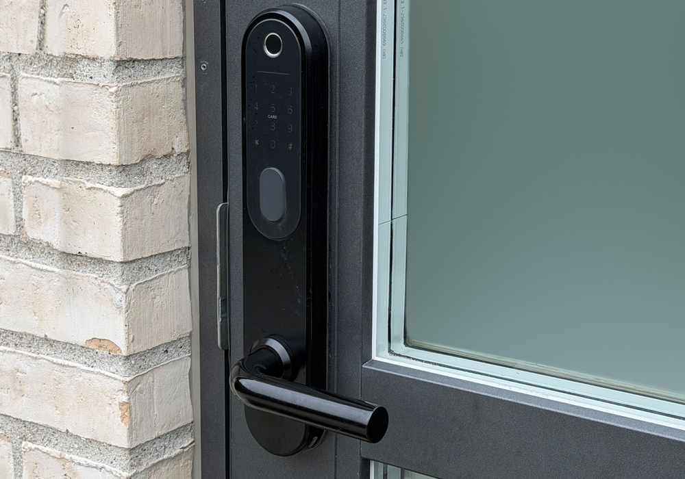
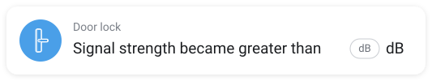
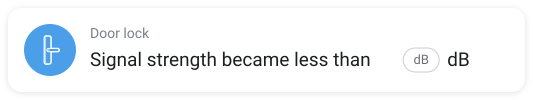
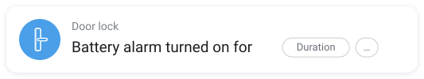
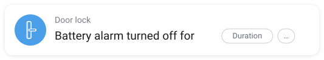
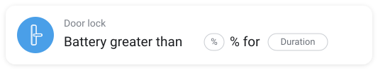
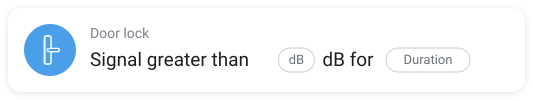
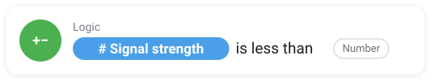
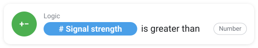

# TTLock for Homey

**Control and monitor your TTLock smart locks.**

Lock and unlock your door from Homey, keep an eye on the battery, and see who opened it and how —
no extra hardware, no hub, just your existing [TTLock](https://www.ttlock.com/) account. If it
works in the TTLock app, it shows up here.

Build flows around your door: turn on the hallway light when someone unlocks it with a fingerprint,
get a notification when the lock raises a tamper alert, or lock up automatically when everyone has
left. It works over TTLock's official cloud API, so there's nothing to install on your lock.

## Supported devices

TTLock smart door locks connected to a TTLock Gateway (Wi-Fi or Ethernet), added to your TTLock
account in the TTLock app.

| Capability | Details |
| --- | --- |
| 🔒 Lock / unlock | From the Homey app, flows, or voice assistants connected to Homey |
| 🔋 Battery | Level and low-battery alarm |
| 📶 Gateway signal | Signal strength, to spot a lock drifting out of range |
| 🚪 Door sensor | Open/closed, for locks that have one |
| 🔁 Auto Lock, Lock Sound | Toggles; plus a read-only Passage Mode indicator |
| 👤 Last operator & trigger | Who last locked/unlocked and how (needs the webhook) |

## Flow cards

The three triggers — *Lock was…*, *Tamper alert* and *Too many invalid
attempts* — only fire when the [TTLock webhook](#getting-near-instant-updates-optional) is set up.

**When…**

**And…**

**Then…**

## Creating a TTLock OAuth app

TTLock requires every app that talks to their cloud API to have its own registered OAuth
application — this one isn't shared between users, so you'll need to create your own once (the
same requirement applies to [hass-ttlock](https://github.com/jbergler/hass-ttlock), the equivalent
Home Assistant integration, if you've set that up before):

1. Go to [open.ttlock.com/manager](https://open.ttlock.com/manager) and create an account.
2. Register an application. This takes a few days to get approved by TTLock.
3. Once approved, note down its **Client ID** and **Client Secret**.

## Getting started

1. Install **TTLock** from the [Homey App Store](https://homey.app).
2. Open the app's Settings in Homey and enter the Client ID/Secret from the previous section.
3. In the Homey app, add a new device and choose **TTLock**.
4. Log in with your TTLock account — the same username and password you use in the TTLock mobile
   app.
5. Pick the lock(s) you want to add and finish the pairing wizard. That's it — your locks are now
   ready to use in Homey, including in flows.
6. *(Optional)* To lock and unlock by tapping the device tile, open the lock's settings in Homey
   and set **Quick Action** to **Locked**. Homey doesn't preselect one for locks, so by default
   the tile does nothing when tapped.

**Requirements:** a TTLock smart lock connected to a TTLock Gateway (Wi-Fi or Ethernet), a TTLock
account with that lock already added in the TTLock app, and your own TTLock OAuth app (see above).

## Getting near-instant updates (optional)

By default the app re-checks lock state every 30 minutes (battery and other settings every 6 hours;
both adjustable in the device settings) to stay within TTLock's free API quota, so changes can
take a while to show up in Homey. For near-instant updates instead, wire up TTLock's webhook:

1. Open the app's Settings in Homey — under "Real-time updates" you'll find your webhook URL.
2. Go back to [open.ttlock.com/manager](https://open.ttlock.com/manager), open your application,
   and paste that URL into its callback URL field.
3. Lock or unlock the door (from the TTLock app, a keypad, fingerprint, etc.) and the lock's state,
   "Last Operator", and "Last Trigger" should update in Homey within a couple of seconds.

Without this step everything still works, just on the slower poll.

## Support

Found a bug or have a feature request? Please open an issue on the
[GitHub issue tracker](https://github.com/briis/ttlock-homey/issues).

## Want to contribute or build this app yourself?

See [DEVELOPMENT.md](DEVELOPMENT.md) for setup, project structure, and the publishing workflow.

## Privacy

See [PRIVACY.md](PRIVACY.md) for what this app stores and sends, and to whom.

## License

[MIT](LICENSE)
